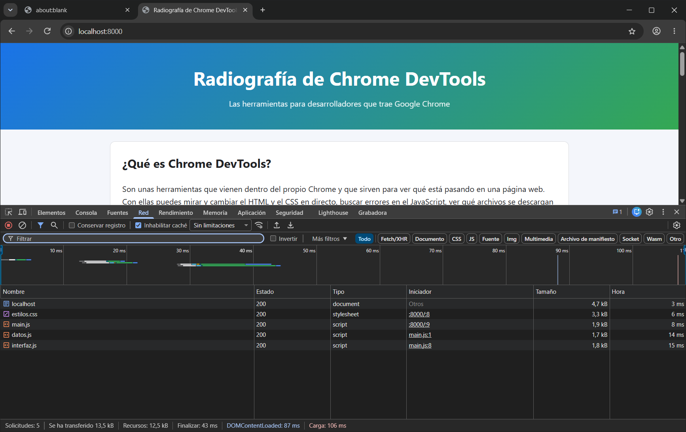

# Radiografía de Chrome DevTools

En esta práctica he hecho una página sobre **Chrome DevTools**, las herramientas para desarrolladores que vienen en Google Chrome.
Es la continuación de la radiografía del tema anterior, y ahora tiene interacción con JavaScript.
No he usado ningún framework ni librería, solo la API del DOM.

## Cómo ejecutarla

Los scripts se cargan como módulos (`type="module"`), así que la página no funciona si se abre con doble clic.
Hay que abrirla desde un servidor local. Yo lo hago de una de estas dos formas:

- **Con Python:** desde la carpeta del proyecto ejecuto `python -m http.server 8000` y abro http://localhost:8000
- **Con VS Code:** con la extensión Live Server, clic derecho en `index.html` y luego "Open with Live Server".

## Estructura

```
index.html
css/estilos.css
js/main.js        selecciona los elementos y registra los eventos
js/datos.js       el array con los paneles de DevTools
js/interfaz.js    las funciones que cambian el DOM
README.md
```

## Qué he añadido

- **Fase A:** el botón "Probar la consola" tiene dos manejadores de `click`.
  Uno cambia el mensaje de la página con `textContent` y el otro escribe en la consola.
- **Fase B:** el botón "Ver más información" enseña u oculta una sección con cómo abrir DevTools, sus ventajas y algunas extensiones.
  Uso `classList.toggle` y voy cambiando el texto del botón y el `aria-expanded`.
- **Fase C:** los paneles (Elementos, Consola, Red...) están en un array de objetos en `datos.js`.
  Las tarjetas se crean desde JavaScript con `createElement`, `textContent` y `append`.
- **Fase D:** hay un buscador que filtra las tarjetas mientras escribes, por nombre o por descripción.
  Da igual si escribes con mayúsculas o sin tildes, y si no encuentra nada sale un mensaje avisando.

Todo se puede usar con el teclado porque solo hay botones y campos de formulario normales.

## Cliente y servidor

El servidor solo entrega los archivos: el HTML, el CSS y los tres módulos de JavaScript.
El navegador es el que hace todo lo demás: monta la página, aplica los estilos y ejecuta el código de los eventos, las tarjetas y el buscador.
Para comprobar que todo cargaba bien abrí DevTools, fui a la pestaña Red, marqué "Desactivar caché" y recargué.
Salen las peticiones de `index.html`, `estilos.css`, `main.js`, `datos.js` e `interfaz.js`, todas con estado 200.
En la consola no aparece ningún error.


